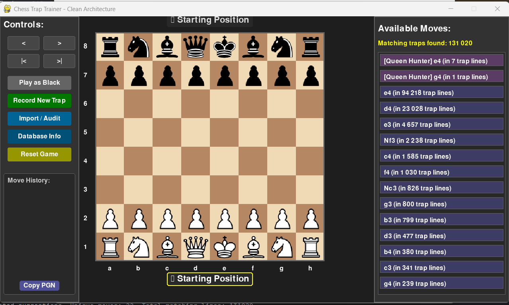

# ♟️ Chess Trap Explorer

A desktop chess trainer that suggests **opening traps in real time** while you play.
It looks up the current *position* (not just the move order) in a PostgreSQL index built from your own PGN archives, and combines it with a personal repertoire of traps you record yourself.



> **Status:** complete, no longer actively developed. Kept as a portfolio project.

**Tech:** Python · pygame · python-chess · PySide6 · PostgreSQL (partitioned position index) · SQLite (opening book) · multiprocessing

---

## ✨ Features

### 🎯 Real-time trap suggestions
- **Two repertoires**
  1. **Main library**: checkmate traps mined from thousands of PGN games (Lichess, chess.com exports, …).
  2. **Custom repertoire**: lines you record in the app, aimed at **checkmate** or a **decisive material win** (queen capture, royal fork).
- **Position-based lookup**: suggestions are keyed on the board position (Shredder-FEN), so transpositions are recognised even when you reach a position through a different move order.
- **Colour-coded suggestions**: 🟪 purple = custom repertoire (shown first), 🟦 blue = main library.
- **Training highlights**: 🟥 red = the suggested move, 🟩 green = the opponent's expected reply.
- **Live opening names** with ECO codes (e.g. *Sicilian Defense: Najdorf Variation*).

### ✍️ Recording mode
- **Record New Trap** starts on an empty board, or saves the game you are currently playing.
- On stop, the trap type is detected automatically: `Checkmate`, `Direct Queen Capture` or `Royal Fork` (king + queen).
- **Save / Cancel / Continue** dialog, and back/forward navigation to fix mistakes mid-recording.

### 🗃️ Data management
- **Bulk PGN import** from a single file or a whole folder, streamed in batches and parsed on **all CPU cores** (`ProcessPoolExecutor`).
- **Audit**: removes duplicates, fixes colours and deletes invalid entries.
- **Custom trap manager**: browse, delete or export your recorded traps to PGN.
- **Database info**: statistics for the library and for the custom repertoire.
- **Copy PGN** of the current game to the clipboard.

---

## 🛠️ Architecture

Layered, with clear responsibilities:

| Layer | Classes |
|---|---|
| UI | `Renderer`, `InputHandler`, PySide6 dialogs |
| Controller | `GameController` (application state and data flow) |
| Services | `TrapService`, `QueenTrapService`, `PGNImportService`, `DatabaseAuditor`, `OpeningDatabase`, `SettingsService` |
| Repositories | `TrapRepository`, `QueenTrapRepository` (PostgreSQL access) |
| Entities | `GameState`, `ChessTrap`, `QueenTrap`, `MoveSuggestion`, `OpeningInfo` |

### Data model (PostgreSQL)
| Table | Purpose |
|---|---|
| `traps` | Library traps (moves, colour, unique hash to avoid duplicates) |
| `queen_traps` | Custom repertoire (trap type, capture square, timestamp) |
| `position_index` | Shredder-FEN → trap and move index. **List-partitioned on the first 3 FEN characters** (`generate_partitions.py` creates the partitions) |
| `move_suggestions_index` | Pre-aggregated suggestions per position, so lookups during play are instant |
| `first_move_suggestions` | Pre-computed suggestions for the starting position |

The opening book is a separate, read-only SQLite file (`openings.db`) built from an ECO PGN.

---

## 🚀 Getting started

### Requirements
- Python 3.9+
- PostgreSQL running locally

### 1. Clone and install
```bash
git clone https://github.com/mmereu97/Chess-Trap-Explorer.git
cd Chess-Trap-Explorer
python -m venv venv
# Windows: .\venv\Scripts\activate    macOS/Linux: source venv/bin/activate
pip install -r requirements.txt
```

### 2. Configure the database
```bash
createdb -U postgres chess_trap_db
cp config.ini.example config.ini     # then edit config.ini with your credentials
python check_connection.py           # should print "CONEXIUNE REUȘITĂ" (connection OK)
```
`config.ini` is git-ignored: never commit your real credentials.

### 3. Create the schema and partitions
```bash
python chess_trap_explorer.py        # first start creates the tables; close the window
python generate_partitions.py        # creates the position_index partitions
```

### 4. Opening book (optional)
Place an ECO PGN file named `eco.pgn` in the project folder, then:
```bash
python build_opening_book.py         # creates openings.db
```

### 5. Run
```bash
python chess_trap_explorer.py
```

---

## 📖 Usage

1. **Fill the library**: `Import / Audit` → choose a PGN file or folder.
2. **Play**: switch sides with `Play as White` / `Play as Black`; navigate with `|<  <  >  >|`.
3. **Learn**: click a suggestion to highlight it, play it, and watch the green highlight for the expected reply.
4. **Build your repertoire**: `Record New Trap` → play the line → `Confirm/Stop` → Save. The trap is available immediately.

---

## 📦 Building a Windows executable

```bash
pip install pyinstaller
pyinstaller chess_trap_explorer.spec
```
The icon (`icon2.ico`) and the `pieces/` folder must be in the folder you run the command from.

---

## 📁 Project structure
```
Chess-Trap-Explorer/
├── chess_trap_explorer.py     # main application
├── config.ini.example         # PostgreSQL connection template
├── check_connection.py        # tests the PostgreSQL connection
├── generate_partitions.py     # creates the position_index partitions
├── build_opening_book.py      # builds openings.db from eco.pgn
├── chess_trap_explorer.spec   # PyInstaller build
├── pieces/                    # piece images (wK.png, bQ.png, …)
└── requirements.txt
```

---

## 👤 Author

Mihai Mereu · [GitHub](https://github.com/mmereu97)
